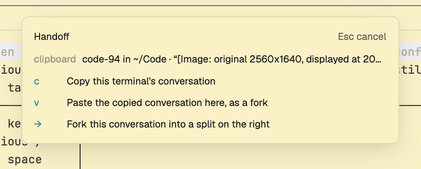

# Handoff

Copy the Claude Code conversation in the focused terminal, paste it as a fork
into another pane, or fork it straight into a split on the right, with one key
each. A thin strip at the bottom of the window shows what's on the fork
clipboard. The same clipboard is shared with Rex, Ghostty and the Herdr TUI,
so a conversation copied in one terminal can be pasted in another.

This file is the brief: enough to build Handoff from an empty folder. The
files next to it are one build of it.

## What you see

- A 22px strip docked at the bottom of the layout, in the theme's `chrome`
  color with a 1px `border` line on top, 11.5px text in `muted`.
- Left: the word **handoff** in semibold, in `accent` when something is
  copied and `foreground` when nothing is.
- Middle, truncated: what's on the clipboard, as "`<name>` in `~/Code/app` ·
  “the last thing you typed”", or "nothing copied".
- Right, in `dim`: the keys bound to the mod, read from `keys()`, as
  "⌥⌘C copy · ⌥⌘V paste · ⌥⌘F fork".

## How it behaves

- **Copy** (`cmd-alt-c`): takes the conversation running in the focused
  terminal and saves it to the fork clipboard. A toast says what was copied.
  If the terminal isn't running Claude and several conversations could be
  meant, a split opens below it with a picker; choosing one copies it and the
  split closes.
- **Paste** (`cmd-alt-v`): types `agentfork paste` into the focused terminal
  and presses Enter, which starts `claude --resume <id> --fork-session` in the
  copied conversation's directory. Use it on a terminal sitting at a shell
  prompt. With nothing copied, a toast says so.
- **Fork** (`cmd-alt-f`): copy, then a new split on the right that runs the
  paste. When a picker is needed, the split runs it and then starts the fork.
- The original conversation is never touched; the fork is a new session.
- The strip updates when the clipboard file changes, including copies made
  from other terminals. No animation; agent statuses aren't shown.

## Built from

- **One mod**, `mods/handoff/` (`main.js`, `mod.json` with `place: "bottom"`,
  `size: 22`). No `layouts/` folder.
- **A `keys.json` snippet**, merged into the person's, three `global` keys
  delivering `handoff.copy`, `handoff.paste` and `handoff.fork` to the mod's
  `nextCommand()`.
- **The agentfork CLI**, `~/.local/bin/agentfork` from
  github.com/calebcauthon/handoff (`make install` links it). It finds
  conversations through Claude Code's `~/.claude/sessions/<pid>.json` files
  and keeps the clipboard at `~/.local/state/agentfork/clipboard.json`. The
  mod runs it with `exec`:
  - copy: `agentfork copy --quiet --pid <foreground pid> --pid <shell pid>
    --cwd <folder>`; exit 0 copied, 3 needs a picker.
  - The pids come from `hc get <terminal> --json` (`foreground.pid`, `pid`),
    the folder from `focused().cwd`.
- **Herdr calls:** `focused()` for the terminal and pane, `hc(["get", …])`,
  `hc(["send", terminal, "<agentfork> paste"])` for paste, `run("pane.split",
  {direction, pane, argv})` for the picker (`down`, `sh -c "exec agentfork
  copy --pick --notify"`) and the fork (`right`, `agentfork paste` or
  `agentfork fork --pick`), `notify()` for results, `readTextFile` and
  `watchFolder` on the state folder for the strip, `keys()` for the hint,
  `theme()` for colors.
- Everything is local: no network. It runs programs (`agentfork`, `hc`, and
  `mkdir -p` for the state folder once).

## Watch out

- The mod needs `~/.local/bin/agentfork`; without it every command toasts an
  error. `make install herdr` from the repo installs both.
- Copy is exact only because herdr-core reports the terminal's foreground pid.
  Without pids it falls back to the folder, then to the one conversation
  active in the last 30 seconds, then to the picker.
- A copy must stay docked (or placed by a layout) to receive key commands;
  `place: "none"` would make the keys do nothing.
- The keys use `cmd`; on Linux and Windows bind `ctrl-alt-c` etc. instead.
- Only this machine: the clipboard and `~/.claude` are local, so copy and
  paste on a remote machine's space aren't supported.
- Only Claude Code; Codex has no pid-to-session file.
- `busy` guards against two commands overlapping; a second key while one
  runs is dropped.

## Done when

- `herdr-app check mods/handoff` passes.
- With Claude running in the focused terminal, `cmd-alt-c` toasts "Copied:
  <name> in <folder>" and the strip shows the same.
- `cmd-alt-v` on a shell prompt starts `claude --resume … --fork-session` in
  the copied conversation's directory.
- `cmd-alt-f` opens a split on the right that starts the fork; the original
  terminal keeps running untouched.
- `cmd-alt-c` on a shell with several conversations active opens a picker
  split below; picking one copies it and closes the split.
- Copying from another terminal (Rex, Ghostty) updates the strip within a
  second.
